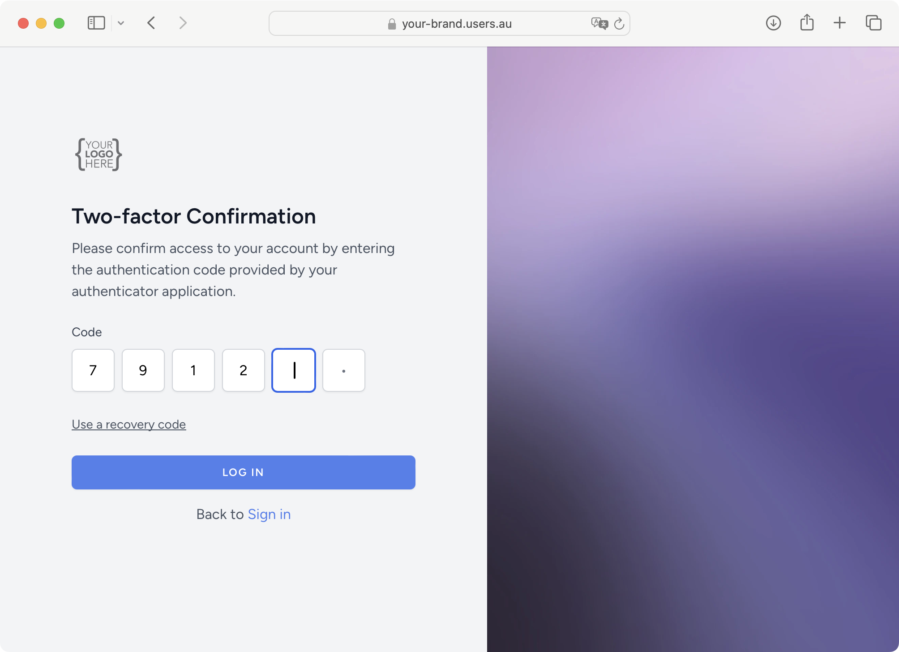
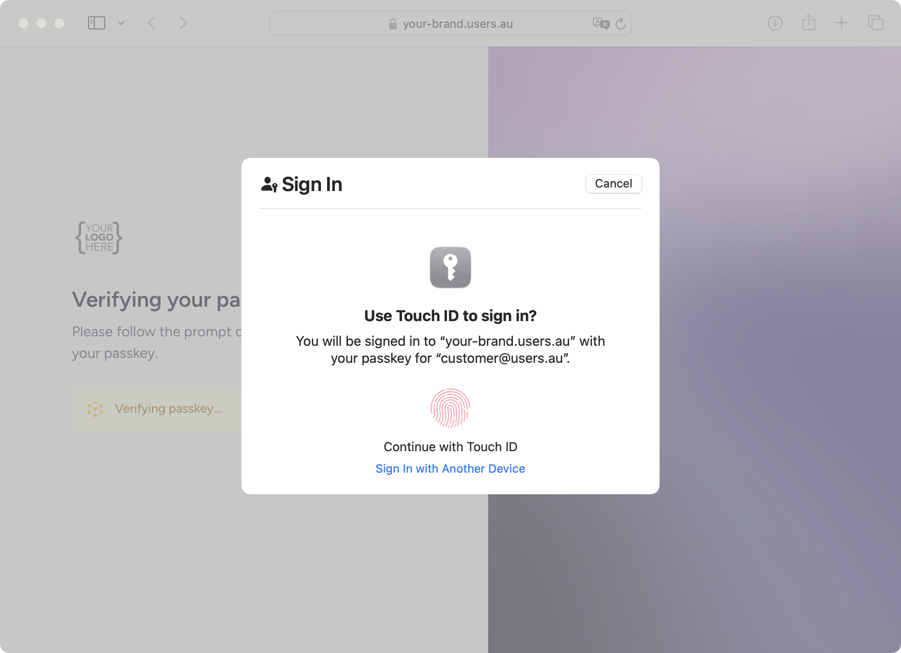

<div align="center">

# Users.au Frontend Client

**One browser OAuth client. Vanilla JS, Vue, React and Next.js.**

[Install](#installation) · [Framework guides](#configuration) · [Screenshots](#usersau-in-action) · [API](#api-reference) · [Users.au](https://www.users.au)

[](https://www.npmjs.com/package/@users-au/client) [](https://www.npmjs.com/package/@users-au/client) [](https://github.com/Users-au/frontend-client/actions/workflows/ci.yml) [](https://opensource.org/licenses/MIT) [](https://github.com/Users-au/frontend-client/issues) [](https://github.com/Users-au/frontend-client/pulls)

</div>

A JavaScript/TypeScript client for public OAuth applications using PKCE, with
framework adapters, profile state and explicit token-refresh operations.

```bash
npm install @users-au/client
```

| 🔐 Public-client OAuth | 🧩 Framework adapters | 🔄 Identity state |
| --- | --- | --- |
| Authorization code flow with PKCE, without a browser client secret. | Core JavaScript, Vue 3, React and a Next.js entry point. | Profile subscriptions, storage adapters and an explicit refresh API. |

> [!IMPORTANT]
> Register a public OAuth client that supports PKCE and permits your app origin's
> token/profile requests. Keep client secrets on a server. For server-managed
> Next.js sessions, start with the [Next.js starter](https://github.com/Users-au/nextjs-starter-kit).

## Users.au in action

Users.au hosts the authentication experience on your identity domain. Enable the
sign-in methods available to your project and connect them to your application
through OAuth. These official product screenshots show the hosted experience.

<table>
  <tr><th>🔑 Branded sign-in & social providers</th><th>🛡️ Multi-factor authentication</th></tr>
  <tr>
    <td width="50%"><a href="docs/images/usersau-social.png"></a></td>
    <td width="50%"><a href="docs/images/usersau-mfa.png"></a></td>
  </tr>
</table>

<details>
<summary><strong>👆 Preview the passkey experience</strong></summary>



</details>

[Explore Users.au](https://www.users.au) · [Create a project](https://my.users.au) · [Image sources](docs/images/README.md)

## Table of Contents

- [Features](#features)
- [Installation](#installation)
- [Configuration](#configuration)
- [Usage — Vanilla JS / TypeScript](#usage--vanilla-js--typescript)
- [Usage — Vue 3](#usage--vue-3)
- [Usage — React](#usage--react)
- [Usage — Next.js](#usage--nextjs)
- [API Reference](#api-reference)
- [OAuth 2.0 Flow Overview](#oauth-20-flow-overview)
- [Troubleshooting](#troubleshooting)
- [License](#license)

---

## Features

- 🔐 **OAuth 2.0 + PKCE** — Secure authentication without exposing a client secret
- 👤 **User Management** — Fetches and caches user profile automatically
- 🔄 **Token Management** — Access & refresh token handling with an explicit `refreshToken()` API
- 💾 **Flexible Storage** — `localStorage`, `sessionStorage`, or an isolated in-memory fallback
- 🎨 **Framework Agnostic** — Core + first-class Vue 3, React, and Next.js integrations
- 🚪 **Single Sign-Out** — Coordinated logout across your app and Users.au

---

## Installation

```bash
npm install @users-au/client
```

Register the exact callback URL with Users.au. This client defaults to
`openid profile email`; set `scopes: []` when your registration expects no scopes,
or supply only supported scopes. `sessionStorage` is useful for a same-tab redirect
flow because it preserves the PKCE verifier across the round trip. Memory storage
does not survive a full-page navigation. Refresh is explicit, not scheduled.

### Peer Dependencies

Install only what you need:

```bash
# For Vue 3
npm install vue

# For React / Next.js
npm install react react-dom
```

---

## Configuration

| Option | Type | Default | Description |
|--------|------|---------|-------------|
| `clientId` | `string` | **required** | Your Users.au OAuth client ID |
| `host` | `string` | **required** | Users.au host URL (e.g. `https://auth.users.au`) |
| `redirectUri` | `string` | **required** | OAuth redirect URI registered with Users.au |
| `afterLoginUrl` | `string` | `'/'` | Redirect URL after successful login |
| `afterLogoutUrl` | `string` | `'/'` | Redirect URL after logout |
| `afterRegisterUrl` | `string` | `'/'` | Redirect URL after registration |
| `scopes` | `string[]` | `['openid', 'profile', 'email', 'preferences:read', 'preferences:write']` | OAuth scopes to request |
| `storage` | `'localStorage' \| 'sessionStorage' \| 'memory'` | `'localStorage'` | Token storage strategy |

---

## Usage — Vanilla JS / TypeScript

```ts
import { UsersauClient } from '@users-au/client';

const client = new UsersauClient({
  clientId: 'your_client_id',
  host: 'https://auth.users.au',
  redirectUri: 'https://yourapp.com/auth/callback',
  afterLoginUrl: '/dashboard',
  afterLogoutUrl: '/',
  scopes: [], // Use only scopes supported by your registration.
  storage: 'sessionStorage',
});

// Login
document.getElementById('login-btn')?.addEventListener('click', () => {
  client.login();
});

// Logout
document.getElementById('logout-btn')?.addEventListener('click', () => {
  client.logout();
});

// Register
document.getElementById('register-btn')?.addEventListener('click', () => {
  client.register();
});

// Manage account
document.getElementById('account-btn')?.addEventListener('click', () => {
  client.account();
});

// On your callback page (https://yourapp.com/auth/callback)
await client.handleCallback();

// Check auth state
console.log(client.isAuthenticated);  // true | false
console.log(client.user);             // UsersauUser | null

// Subscribe to state changes
const unsubscribe = client.subscribe((state) => {
  console.log('Signed in:', state.isAuthenticated); // Do not log tokens.
});
```

---

## Usage — Vue 3

### 1. Install the plugin (`main.ts`)

```ts
import { createApp } from 'vue';
import { UsersauPlugin } from '@users-au/client/vue';
import App from './App.vue';

const app = createApp(App);

app.use(UsersauPlugin, {
  clientId: 'your_client_id',
  host: 'https://auth.users.au',
  redirectUri: 'https://yourapp.com/auth/callback',
  afterLoginUrl: '/dashboard',
  scopes: [],
  storage: 'sessionStorage',
});

app.mount('#app');
```

### 2. Use the composable

```vue
<script setup lang="ts">
import { useUsersau } from '@users-au/client/vue';

const { user, isAuthenticated, isLoading, login, logout, register, account } = useUsersau();
</script>

<template>
  <div v-if="isLoading">Loading...</div>
  <div v-else-if="isAuthenticated">
    <p>Welcome, {{ user?.name }}!</p>
    
    <button @click="account">Manage Account</button>
    <button @click="logout">Logout</button>
  </div>
  <div v-else>
    <button @click="login">Login with Users.au</button>
    <button @click="register">Register with Users.au</button>
  </div>
</template>
```

### 3. Callback page (`/auth/callback`)

```vue
<script setup lang="ts">
import { onMounted } from 'vue';
import { useUsersau } from '@users-au/client/vue';

const { handleCallback, error } = useUsersau();
onMounted(() => {
  void handleCallback().catch(() => { /* error is exposed by useUsersau() */ });
});
</script>

<template>
  <div v-if="error">Sign-in failed. Start again from your login page.</div>
  <div v-else>Processing login...</div>
</template>
```

---

## Usage — React

### 1. Wrap your app with the provider

```tsx
// app.tsx
import { UsersauProvider } from '@users-au/client/react';

export default function App() {
  return (
    <UsersauProvider
      config={{
        clientId: 'your_client_id',
        host: 'https://auth.users.au',
        redirectUri: 'https://yourapp.com/auth/callback',
        afterLoginUrl: '/dashboard',
        scopes: [],
        storage: 'sessionStorage',
      }}
    >
      <MyApp />
    </UsersauProvider>
  );
}
```

### 2. Use the hook

```tsx
import { useUsersau } from '@users-au/client/react';

export function Navbar() {
  const { user, isAuthenticated, login, logout, register, account } = useUsersau();

  if (isAuthenticated) {
    return (
      <nav>
        <span>Welcome, {user?.name}</span>
        <button onClick={account}>Manage Account</button>
        <button onClick={logout}>Logout</button>
      </nav>
    );
  }

  return (
    <nav>
      <button onClick={login}>Login with Users.au</button>
      <button onClick={register}>Register with Users.au</button>
    </nav>
  );
}
```

### 3. Callback page

```tsx
// A client-side callback route; keep the provider mounted above it.
import { useEffect, useRef } from 'react';
import { useUsersau } from '@users-au/client/react';

export default function CallbackPage() {
  const { handleCallback, error } = useUsersau();
  const started = useRef(false);

  useEffect(() => {
    if (started.current) return;
    started.current = true;
    void handleCallback().catch(() => { /* error is exposed by useUsersau() */ });
  }, [handleCallback]);

  if (error) return <p>Sign-in failed. Start again from your login page.</p>;
  return <p>Processing login...</p>;
}
```

---

## Usage — Next.js

The `@users-au/client/nextjs` entry re-exports everything from the React integration as a convenience browser integration. Server-side construction uses an in-memory fallback; this entry does not create a server session or authorize your backend.

```tsx
// app/providers.tsx  ('use client')
'use client';
import type { ReactNode } from 'react';
import { UsersauProvider } from '@users-au/client/nextjs';

export function Providers({ children }: { children: ReactNode }) {
  return (
    <UsersauProvider
      config={{
        clientId: process.env.NEXT_PUBLIC_USERSAU_CLIENT_ID!,
        host: process.env.NEXT_PUBLIC_USERSAU_HOST!,
        redirectUri: `${process.env.NEXT_PUBLIC_APP_URL}/auth/callback`,
        afterLoginUrl: '/dashboard',
        scopes: [],
        storage: 'sessionStorage',
      }}
    >
      {children}
    </UsersauProvider>
  );
}
```

```tsx
// app/layout.tsx
import type { ReactNode } from 'react';
import { Providers } from './providers';

export default function RootLayout({ children }: { children: ReactNode }) {
  return <html lang="en"><body><Providers>{children}</Providers></body></html>;
}
```

```tsx
// app/auth/callback/page.tsx  ('use client')
'use client';
import { useEffect, useRef } from 'react';
import { useUsersau } from '@users-au/client/nextjs';

export default function CallbackPage() {
  const { handleCallback, error } = useUsersau();
  const started = useRef(false);

  useEffect(() => {
    if (started.current) return;
    started.current = true;
    // Without explicit params, the SDK reads the URL and redirects after success.
    void handleCallback().catch(() => { /* error is exposed by useUsersau() */ });
  }, [handleCallback]);

  if (error) return <p>Sign-in failed. Start again from your login page.</p>;
  return <p>Processing login...</p>;
}
```

#### Environment Variables (`.env.local`)

```env
NEXT_PUBLIC_USERSAU_CLIENT_ID="your_client_id"
NEXT_PUBLIC_USERSAU_HOST="https://auth.users.au"
NEXT_PUBLIC_APP_URL="https://yourapp.com"
```

> **Using a client secret or protecting server data?** Follow the [Next.js starter](https://github.com/Users-au/nextjs-starter-kit) for server-side state/CSRF validation, private credentials, minimal sessions and per-request authorization. The browser SDK does not supply those server controls.

---

## API Reference

### `UsersauClient`

| Method | Returns | Description |
|--------|---------|-------------|
| `login()` | `Promise<void>` | Redirect to Users.au authorization |
| `register()` | `void` | Redirect to Users.au registration |
| `handleCallback(params?)` | `Promise<UsersauUser>` | Exchange code for tokens, fetch user |
| `logout()` | `void` | Clear tokens, redirect to Users.au logout |
| `account()` | `void` | Redirect to Users.au account page |
| `refreshToken()` | `Promise<UsersauTokens>` | Refresh access token |
| `syncUser()` | `Promise<UsersauUser>` | Re-fetch user info from Users.au |
| `subscribe(fn)` | `() => void` | Subscribe to state changes (returns unsubscribe) |

| Property | Type | Description |
|----------|------|-------------|
| `user` | `UsersauUser \| null` | Current authenticated user |
| `isAuthenticated` | `boolean` | Whether user is logged in |
| `accessToken` | `string \| null` | Current access token |
| `state` | `UsersauState` | Full reactive state snapshot |

`handleCallback()` reads the current URL and navigates to `afterLoginUrl` after
success. When passing explicit `{ code, state }`, it returns the user without
navigating; your callback page must perform the next navigation itself.

### `UsersauUser`

```ts
interface UsersauUser {
  id: string;
  nickname?: string;
  name: string;
  email: string;
  avatar?: string;
}
```

---

## OAuth 2.0 Flow Overview

```
User clicks Login
      │
      ▼
client.login()  ──generates PKCE verifier + challenge──►  {host}/oauth/authorize
                                                                  │
                                                            User authenticates
                                                                  │
                                                          Redirect to redirectUri
                                                          ?code=...&state=...
                                                                  │
      ◄──────────────────────────────────────────────────────────┘
      │
client.handleCallback()
      │
      ├── POST {host}/oauth/token  (code + verifier)
      │         └── returns access_token, refresh_token
      │
      └── GET {host}/api/user  (Bearer token)
                └── returns user profile
                      │
                      └── Redirect to afterLoginUrl
```

---

## Troubleshooting

**`OAuth state mismatch` error**
The `state` parameter returned in the callback doesn't match what was stored. Ensure cookies/localStorage are not blocked and the login flow was initiated from the same browser session.

**`No PKCE verifier found` error**
The PKCE code verifier wasn't found in storage. This can happen if:
- The user opened the callback URL in a different browser/tab
- Storage was cleared between login and callback
- Third-party cookie blocking affected `localStorage`

**SSR / Next.js hydration issues**
Use `'use client'` on components that call `useUsersau()`. Render browser-dependent identity UI after hydration. Keep `sessionStorage` or `localStorage` for redirect flows; the isolated memory fallback cannot preserve a verifier across a reload.

---

## Choose your integration

| Project | Use it when you want to… |
| --- | --- |
| [Next.js starter](https://github.com/Users-au/nextjs-starter-kit) | Start a Next.js app with server-managed OAuth sessions and a protected dashboard. |
| [Laravel starter](https://github.com/Users-au/laravel-starter-kit) | Start a Laravel app with Blade templates and Users.au integration. |
| [Laravel client](https://github.com/Users-au/laravel-client) | Add local user synchronization and authentication routes to a Laravel app. |
| [Socialite provider](https://github.com/Users-au/socialite-provider) | Connect an existing Laravel Socialite authentication flow to Users.au. |
| [**Frontend client — this repo**](https://github.com/Users-au/frontend-client) | Use public-client OAuth with PKCE in JavaScript, Vue or React. |

## Contributing

See [CONTRIBUTING.md](CONTRIBUTING.md).

## License

MIT © [Users.au](https://users.au)

## Account preferences and complete OIDC claims

Client 2 implements the shared profile/preferences contract in Vanilla, React, Vue and browser-only Next.js adapters. See [the contract and migration guide](docs/identity-preferences.md) for versioned writes, refresh, conflict handling, issuer-isolated storage and server-only alternatives.
